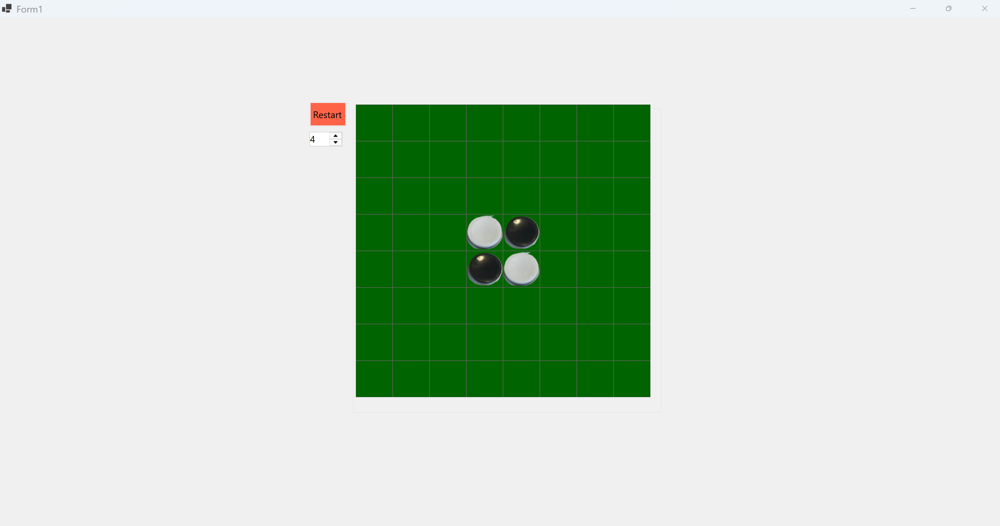

# Othello (Reversi) Game Engine & AI

An interactive 8×8 Othello (Reversi) desktop application built in C# using Windows Forms. Features a single-player mode against a game AI with configurable difficulty and complete rules engine support.

---
# Othello

___

## Features

* **Single-Player Mode:** Play against an integrated game AI designed for dynamic decision-making.
* **Algorithmic Board Logic:** Uses recursive grid traversal to scan move validity across all 8 directional vectors, handle piece-flipping, and manage temporary state validation.
* **Automated Rules Handling:** Includes edge-case processing, such as automatic turn-passing when no valid moves remain for a player.
* **Configurable AI Depth:** Adjust the search depth to scale the lookahead complexity and difficulty of the AI.

---

## Tech Stack & Concepts

* **Language:** C#
* **GUI Framework:** Windows Forms (.NET)
* **Algorithms & Logic:** Recursion, Directional Vector Scanning, Minimax Search, State Validation

---

## Architecture & Attribution

* **Core Engine & GUI:** Custom implementation of game rules, board visualization, move scanning, and state transitions built from scratch in C#.
* **AI Framework:** The Minimax solver with Alpha-Beta pruning (`MinimaxSolver.cs` and `TicTacToe/TMinimaxSolver.cs`) was provided by my teacher as part of the course. I integrated it with my own game positions to handle tree traversal and lookahead depth evaluation.

---

