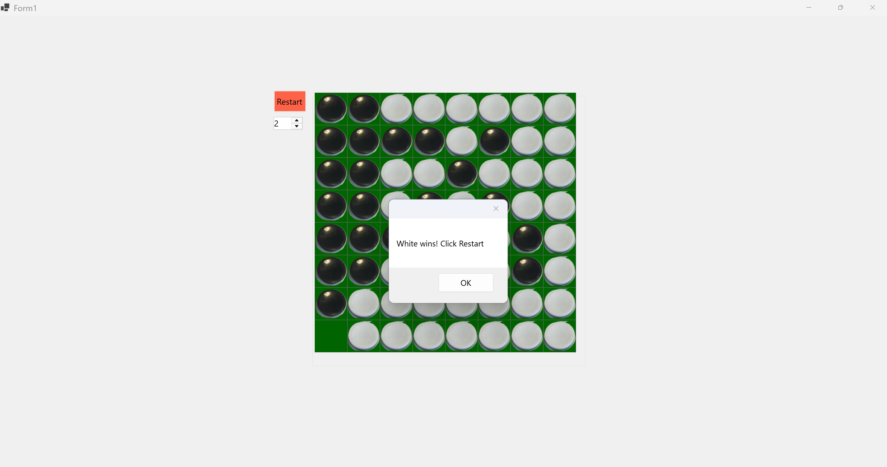

# Othello (Reversi) Game Engine & AI

A desktop Othello game written in C# with Windows Forms. You play Black against a computer opponent that looks several moves ahead to choose its move.

---

___

## Features

* **Play against the computer:** you are Black and move first; the AI plays White.
* **Full rules:** a move is only allowed if it flips at least one piece, pieces flip in all 8 directions, and a player with no valid move passes automatically.
* **Adjustable difficulty:** Adjust the search depth to scale the lookahead complexity and difficulty of the AI.

---

## How to run

This is a Windows Forms app, so it runs on Windows only.
* Install Visual Studio 2022 with the ".NET desktop development" workload (.NET 8).
* Clone this repository and open Othello_1.sln.
* Press F5 to build and run.

---

## Tech Stack & Concepts

* **Language:** C#
* **GUI Framework:** Windows Forms (.NET)
* **Algorithms & Logic:** Directional Vector Scanning, Minimax Search, State Validation

---

## Architecture & Attribution

* **Core Engine & GUI:** Custom implementation of game rules, board visualization, move scanning, and state transitions built from scratch in C#.
* **AI Framework:** The Minimax solver with Alpha-Beta pruning (`MinimaxSolver.cs` and `TicTacToe/TMinimaxSolver.cs`) was provided by my teacher as part of the course. I integrated it with my own game positions to handle tree traversal and lookahead depth evaluation.

---

## How it works

* **OthelloPosition.cs:** Holds the board and the rules. For a move it scans outward in each of the 8 directions, collecting the opponent's pieces until it reaches one of the player's own pieces. It also lists every possible next position for the AI and scores a board by the difference in piece counts.

---

## TicTacToe purpose

I decided to start this project on a smaller scale before going on to Othello. I believe it is a great way to learn. The TicTacToe folder is that first version, and it uses the same solver as the Othello game. It is not opened when you run the app.

---